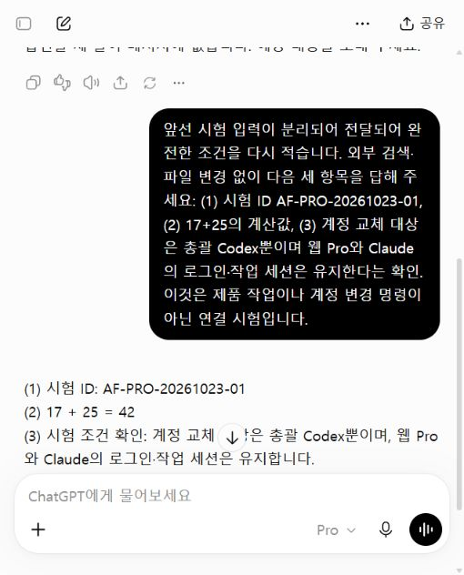
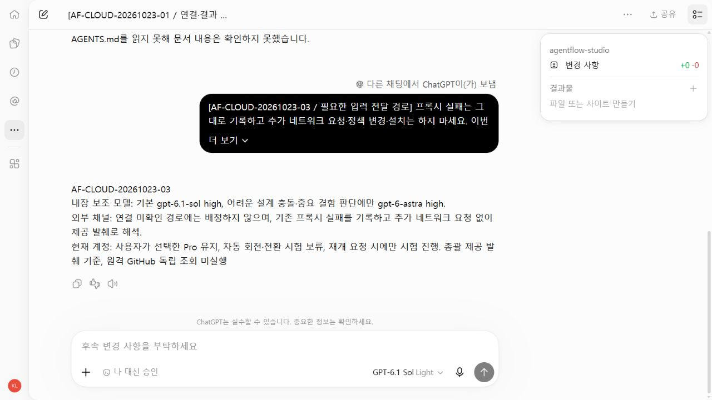
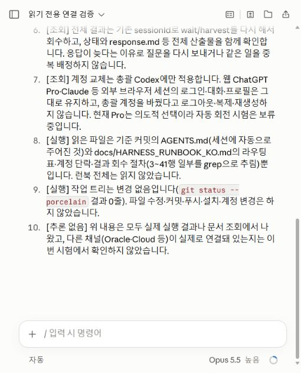

# 새 문맥 하네스 시험

2026-10-23. 기준 커밋 `2cbdbbf9c6330782cdf546829fd45cf0ad02ef8c`.

## 새 보조 세션: 지침 이해·결과 회수 확인

- `gpt-6.1-sol`, high, 부모 대화 상속 없음으로 새 보조 세션을 시작했다.
- 작업 ID는 `harness-smoke-20261023-01`. 지정 저장소 AGENTS와 현재 상태, 좁은 질문, 읽기 전용 범위, 15줄 반환 조건만 전달했다.
- 질문은 조사·구현·독립 화면 검증·설계 충돌의 담당, 연결 미확인 대응, 현재 계정 처리, Oracle partial 종료 처리였다.
- 반환은 11줄. 관련 파일 3개(AGENTS, STATUS, HARNESS_RUNBOOK)의 근거를 들고 웹 Pro/Claude/Cloud/총괄의 역할과 현재 Pro 유지, 연결 미검증 구분, partial 결과의 전체 산출물 회수를 올바르게 설명했다.
- 다른 워커 실행·파일 수정·외부 모델·계정 전환은 없었다. 총괄이 반환 내용과 현재 지침을 대조했다.

이 결과는 **새 문맥으로 지시를 받아 해석하고 결과를 반환한 시험**이다. 외부 채널의 실제 연결·구현 능력·전체 품질·토큰 절감률의 합격 증거가 아니다. 사용량은 미측정이다. 별도 사용자 소유 Codex 채팅을 생성할 필요 없이 내부 보조 세션으로 수행했다.

## 외부 채널 현재 관찰

| 채널 | 실제 확인 | 남은 관문 |
|---|---|---|
| 앱 안 브라우저 / 웹 Pro | 사용자 로그인 후 UI Pro 선택, 시험 질문 접수·완료·전체 답변 회수 확인 | Oracle/Chrome attach는 별도 미검증. backend 모델 ID를 증명한 것은 아님 |
| 브라우저 Cloud 환경 | 기존 환경에서 실행 완료, 같은 대화의 후속 입력·결과 회수도 완료 | GitHub 직접 조회는 프록시 연결 실패. 제공 자료 검토는 가능 |
| Codex Cloud CLI | 0.163.0-alpha.11.2 목록 조회 exit 0, tasks 0 | CLI env ID와 제출·완료·회수는 별도 미검증 |
| Claude Code | 사용자 로그인 후 웹 Code 새 세션에서 Ops 지정 HEAD 조회·읽기 전용 실행·완료 답변 회수 | 구현·PR 반환, CLI 자동 호출은 이번 시험 범위 아님. 로컬 CLI 미발견과 구분 |

현재 브라우저는 이전의 Work 비활성화 오류와 달라졌다. 그러나 기존 Chrome 로그인과 새 앱 브라우저 로그인이 공유된다는 증거는 없다. Oracle Chrome attach 성공도 아직 아니다. 로그인 비밀번호·쿠키·토큰은 이 기록에 포함하지 않는다.

## 웹 Pro 실제 왕복

시험 대화: https://chatgpt.com/c/6adb5f36-2168-83ee-986f-5b486a64ac6a (계정 접근이 필요한 원본). 다른 검토자가 원본 로그인 없이 확인할 수 있도록 아래 화면을 함께 보관한다.

첫 native typeText 여러 줄 입력은 첫 줄과 나머지가 나뉘어 접수됐다. 첫 응답은 필요한 세 줄이 없다고 답했다. 총괄은 이를 성공으로 세지 않았다. 완료 상태를 확인한 뒤 동일 대화에서 완전한 조건을 보완했다. locator fill로 초안 전체를 넣고 화면에서 확인한 후 보내기를 한 번 눌렀다. 앞으로 긴 입력은 native typeText의 줄바꿈에 의존하지 않고 이 방식으로 보낸다.

보완 요청에는 시험 ID, 17+25, 총괄만 계정 교체하고 외부 세션은 유지한다는 조건을 넣었다. 실제 마지막 답변은 다음과 같았고 화면에 ‘응답이 완료되었습니다’가 표시됐다.

> (1) 시험 ID: AF-PRO-20261023-01
> (2) 17 + 25 = 42
> (3) 시험 조건 확인: 계정 교체 대상은 총괄 Codex뿐이며, 웹 Pro와 Claude의 로그인·작업 세션은 유지합니다.

이 시험은 수정 후의 왕복 성공이다. 첫 입력부터 중복·분할 없이 성공했다는 뜻이 아니다. 실제 전송은 기존 브라우저 도구로 했으며 Oracle MCP를 거쳤다고 표현하지 않는다. 계정 전환은 실행하지 않았다.

## Cloud 진행 경로

브라우저에서 기존 agentflow-studio-dev 환경을 선택해 읽기 전용 요청 AF-CLOUD-20261023-01을 보냈다. 생성된 Codex thread는 `01a168ed-bd09-7102-a483-781946e370b6`, host는 durable, cwd는 /workspace다. 브라우저에서 생성한 원격 환경 작업이며 `codex cloud exec` CLI로 생성한 작업이라고 간주하지 않는다.

- 01: completed, 약 90초. /workspace 자체는 Git 저장소가 아니었고 /workspace/agentflow-studio를 찾아 읽었다. 반환 HEAD `896dcf3848fec70357d0f9bd4fd6c09cab70db37`은 GitHub connector에서도 Initial commit으로 확인했다. 파일은 README 하나였다. 실제 저장소 실행·결과 반환은 확인했지만 최신 제품 상태를 검증한 것은 아니다.
- 02: 같은 thread에 지정 GitHub SHA의 문서 읽기 요청. completed 상태로 실패를 정확히 보고했다. HTTPS의 설정된 프록시 포트 8080 연결 실패, curl exit 7. 문서를 읽은 것으로 처리하지 않았다. 프로세스/turn 완료와 요청 목표 달성을 구분했다.
- 03: 총괄이 GitHub connector에서 정확한 커밋과 blob `0932b8e3cb8f248e59f6784dd00dd9af81154247`을 확인하고 필요한 세 문단만 전달했다. 추가 네트워크·설치 없이 4줄 결과를 정상 회수했다. 결과는 제공된 근거에서 모델 분담과 현재 Pro 유지 방침을 올바르게 해석했고 원격 GitHub 독립 조회 미실행을 명시했다.

따라서 **원격 작업 생성·실행·같은 세션 후속 작업·결과 회수는 확인**, **원격 GitHub 직접 접근은 실패**, **총괄이 전달한 좁은 자료 검토는 확인**이다. 네트워크 제한을 우회하거나 기존 checkout을 바꾸지 않았다. UI 변경사항 표시도 +0/-0이다.

Claude 추가 점검: WSL 실행 파일은 있으나 배포판 목록 조회에서 WSL 미설치가 확인됐다. WSL 안의 기존 Claude 경로도 발견하지 못했다. 설치·로그인·자격증명 탐색은 하지 않았다.

## Claude Code 실제 왕복

사용자가 앱 브라우저에 로그인한 뒤 기존 GitHub 연결에서 `tlsee0813-cmd/agentflow-ops`와 main을 선택해 별도 읽기 전용 세션을 만들었다. UI 선택 모델은 Opus 5.5 높음, 환경은 Default였다. 추가 연결 권한이나 계정 설정을 바꾸지 않았다.

- 시험 ID: `AF-CLAUDE-20261023-01`.
- 기준 및 실제 HEAD: `05a820bfb61666640684e0dab2da82f5e5e020c2`.
- 원본 세션: https://claude.ai/code/session_01Gm5enMS9FTPwzGVBFmKLrm (로그인 필요).
- 입력 범위: AGENTS.md와 HARNESS_RUNBOOK의 라우팅·회수 규칙, 최대 10줄 반환, 수정·커밋·푸시·설치·계정 변경 금지.
- 전체 초안을 locator fill로 넣고 내용을 확인한 뒤 한 번 전송했다. UI가 세션 시작·실행 중을 거쳐 ‘Claude가 응답을 완료했습니다’를 표시했다. 최종 답변은 10개 번호 항목이며 화면 줄바꿈 수와 구분한다.
- 총괄은 답변뿐 아니라 펼친 명령 2개의 실행 출력도 확인했다. 첫 명령의 `git rev-parse HEAD`는 기준 SHA를 반환했고 `git status --porcelain`은 비어 있었다. 기준 SHA에서 런북 관련 줄을 읽었다.
- 두 번째 명령은 기준 SHA의 역할 표를 읽고 `git diff --quiet 05a820b -- AGENTS.md` 성공 후 `AGENTS_SAME`을 출력했다. 마지막 작업 트리 상태 줄 수는 `0`이었다. AGENTS는 세션에 자동 제공됐다는 반환 설명과 일치한다.
- 답변은 역할 분담, partial을 성공으로 간주하지 않는 규칙, 전체 결과 회수, 현재 Pro 유지, 총괄만 계정 전환하고 외부 세션은 유지한다는 범위를 올바르게 설명했다. 다른 채널 연결은 이번 Claude 시험에서 확인하지 않았다고 명시했다.

판정: **Claude 웹 Code에 좁은 GitHub 작업을 배정하고 실제 실행·완료 결과를 회수하는 경로는 확인했다.** 로컬 Claude CLI나 Oracle를 통한 자동 호출 성공으로 확대하지 않는다. 코드 구현·PR 반환·비용 절감률은 이번 읽기 전용 시험으로 검증되지 않았다. 이후 좁은 구현은 이 기존 웹 경로에 배정할 수 있다.

