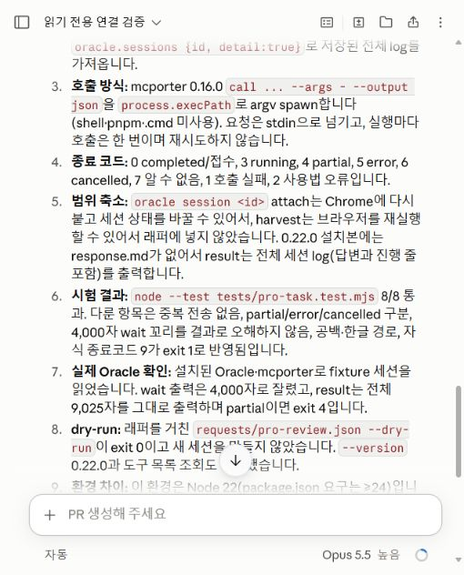

# 실제 작업 조립 결과

2026-10-23 KST. 기준 main `53c70ef1b94ad244508360fc05ecd807ac83245d`. 계정 회전은 사용자 지시대로 보류했다.

## 연결한 흐름

총괄 → 웹 Pro 조사/검토 → Claude 웹 Code 구현 → GitHub 브랜치 회수 → Windows 실행·독립 수정 → 총괄 통합. Oracle 0.22.0과 mcporter 0.16.0의 기존 실행·저장·조회 기능을 재사용했다. 새 작업 큐나 서버는 만들지 않았다.

- Pro 제출: `node scripts/pro-task.mjs submit REQUEST.json`. Oracle 원본 CLI를 foreground로 유지한다. Codex 실행 도구가 반환한 process session은 유지하고 총괄은 다른 일을 한다.
- 상태·전체 결과: 같은 Oracle ID로 `status` / `result`. mcporter는 이 읽기 조회에만 사용한다. result는 마지막 4천 자가 아닌 저장된 전체 로그다.
- Claude: 기존 웹 Code에서 실제 구현을 수행하고 지정 브랜치·커밋으로 반환한다. 화면 조작과 이미지 확인은 기존 CUA 도구를 유지한다.

## 실제 수행

1. Claude에 scripts/pro-task.mjs, tests/pro-task.test.mjs, docs/PRO_TASK_CLI_KO.md만 맡겼다. 작성자는 `claude/pensive-ride-7buz4d`의 `c03ed872c103ef2d08947148611a017eae5f8aee`로 3파일을 push했다. 총괄이 정확한 SHA를 fetch했다. [원본 세션](https://claude.ai/code/session_01Gm5enMS9FTPwzGVBFmKLrm).
2. 작성자 Linux 검사와 별개로 Windows Node 24.19.0에서 실행했다. Sol High 독립 검토가 즉시 partial/failed 성공 오판과 원본 결과에 붙는 줄바꿈을 찾고 수정했다. 실제 실행 경로를 원본 CLI로 바꾼 뒤 최종 테스트 9/9가 통과했다. 원본 dry-run, 종료 전 진행 출력 스트리밍, 공백·한글 argv, 전체 로그, partial/error/cancelled, 자식 실패를 다룬다.
3. 사용자가 Oracle 전용 Chrome에 로그인했다. 원본 CLI 작업 `ops-live-routing-review`가 2분 56초에 completed, exit 0으로 끝났다. 원본 로그가 GPT-6 모델 선택과 Pro thinking 선택을 확인했다. 전체 결과 CLI는 completed, 2,962자를 회수했다. 로그인 쿠키·프로필은 비공개 .ops에만 둔다.
4. 그 답변에서 지적한 Oracle/CUA 회수 규칙 혼동, 저장소와 무관한 조사에도 SHA를 강제하는 규칙을 판단 후 AGENTS에 반영했다. 총괄이 답변을 전달하는 데서 끝내지 않고 운영 지침을 수정했다.
5. 새 전송 명령으로 시작한 `ops-doctor-live-review`는 추가 로그인 없이 같은 프로필을 재사용했고, 2분 06초 후 completed/exit 0이었다. 총괄은 실행 중 문서·GitHub 통합을 진행했고 종료 뒤 같은 ID로 전체 2,387자를 회수했다. 전송·대기 중 독립 작업·전체 결과 회수의 실무 흐름을 확인했다.
6. 이 Pro 정적 검토가 진단 코드의 두 오판을 지적했다. Chrome 경로가 폴더여도 통과하는 access 검사, ‘dry-run failed’ 문자열도 성공으로 보는 정규식이었다. 총괄이 소스를 대조해 채택했고 실행 파일 확인은 stat.isFile, dry-run 확인은 명시적 boolean으로 수정했다. 이는 Pro가 실행한 검사 결과가 아니라 정적 검토 후 로컬에서 수정한 것이다.

최종 진단은 실제 dry-run 검사 9개 통과. 별도의 격리 입력 두 개(Chrome 경로가 디렉터리, dryRun:false와 실패 문구)는 모두 fail/exit 1이었다. CLI 테스트 9개와 이 진단 결과는 서로 다른 검증이다. [운영 규칙 검토 원문](PRO_ROUTING_REVIEW.md) · [진단 코드 검토 원문](PRO_DOCTOR_REVIEW.md).

## 실제로 찾아 고친 연결 차이

- Oracle 프로젝트 config의 manualLoginProfileDir는 설치 0.22의 정제 과정에서 무시됐다. MCP에는 상대 ORACLE_BROWSER_PROFILE_DIR 환경값, 직접 CLI에는 명시적 profile argv를 사용해 같은 로그인 프로필을 지정했다.
- MCP의 Windows Chrome 사전 탐지는 직접 CLI의 설치 경로 fallback과 달랐다. CHROME_PATH를 실제 설치 경로로 지정했다. 첫 실패는 원본 createSession 이전이었고 목록에도 새 세션이 없었다.
- mcporter ephemeral은 호출 종료 때 하위 Oracle worker까지 종료했다. `ops-cli-result-review`는 metadata running만 남고 worker가 사라졌다. runtime/전송 증거가 없지만 전송 여부를 절대 확정하지 않았으며 같은 질문을 다시 보내지 않았다. 이 세션은 실패 기록이며 성공 건수에 포함하지 않는다.
- 원본 keep-alive daemon도 시작 제한 시간 초과, 기존 daemon 종료 확인 오류로 작동하지 않았다. 권한·메타데이터를 바꾸지 않았다. 제출은 이미 성공한 원본 CLI foreground로 바꾸고 MCP는 조회에만 사용했다.

## 병렬 Pro 조사에서 채택한 범위

[Oracle 원본](https://github.com/steipete/oracle/tree/bfd25bd1d85c028af60bb708391d49e936c40701)의 render, 세션 전체 log 회수, 작업 ID 재사용을 채택했다. [chatgpt-browser-channel](https://github.com/tejasdc/chatgpt-browser-channel)과 [BrowserChatBridge](https://github.com/satabd/BrowserChatBridge-Plugin)는 현재 앱 브라우저 로그인에 설치 없이 붙는 도구가 아니므로 추가 도입하지 않았다. 조사 당시의 ‘Oracle 미연결’ 조건은 이후 사용자 로그인과 실제 CLI 실행으로 갱신됐다.

## 범위

Pro는 실제 원본 CLI, Claude는 실제 웹 Code 경로다. 모든 외부 서비스를 하나의 CLI로 연결했다고 주장하지 않는다. Cloud의 직접 GitHub 조회 제한과 DSH 연결, 계정 자동 회전은 이번 실무 흐름의 완료 항목이 아니다. 사용량 절감률은 측정하지 않았다. 원본 세션 로그 전체와 브라우저 프로필은 공개하지 않는다.
